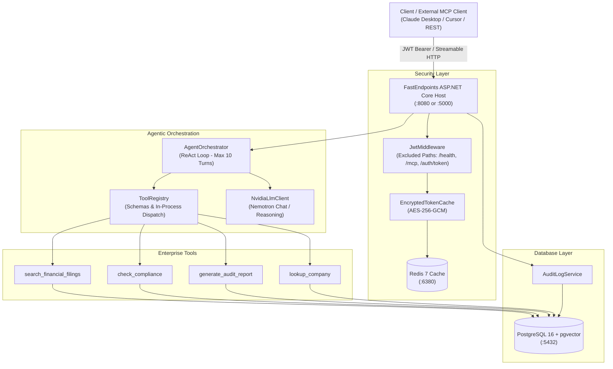

# Agentic AI & MCP Tool Orchestrator

[](https://dotnet.microsoft.com/)
[](https://fast-endpoints.com/)
[](https://modelcontextprotocol.io/)
[](https://github.com/pgvector/pgvector)
[](https://redis.io/)
[](https://build.nvidia.com/)
[](https://github.com/sivasaikakarla/A2AProtocol)
[](LICENSE)

An enterprise-grade **Agentic AI & Model Context Protocol (MCP) Tool Orchestrator** developed with **C# and .NET 10**. Engineered for high-throughput autonomous financial analysis, regulatory compliance verification (SOX-404, SEC Risk Disclosures, Basel-III), and semantic vector retrieval (RAG) over live SEC 10-K regulatory filings.

---

## Key Features

- **Autonomous ReAct Agent Loop (`AgentOrchestrator`)**: Coordinates multi-turn reasoning and tool selection using NVIDIA NIM models, dynamically executing tools, feeding observations back into context, with a 10-turn threshold and cycle prevention.
- **Model Context Protocol (MCP) Compliance**: Standardized Streamable HTTP transport exposed at `/mcp` using `FastEndpoints.Mcp`, allowing native connection from Claude Desktop, Cursor IDE, and custom MCP clients.
- **4 Enterprise MCP Tools**:
  1. `search_financial_filings`: Semantic RAG similarity search via PostgreSQL `pgvector` with grounded LLM citations.
  2. `check_compliance`: Automated auditing engine checking SEC filings against SOX-404, SEC Risk Disclosures, and Basel-III.
  3. `generate_audit_report`: Multi-section executive, risk, and operational audit reports synthesized from filings.
  4. `lookup_company`: Corporate metadata, SEC CIK registry, industry classifications, and indexed filing statistics.
- **AES-256-GCM Encrypted Token Cache**: High-security Redis token storage with authenticated encryption (`AesGcm`) and 128-bit authentication tags.
- **RFC 7807 Problem Details Global Error Handling**: Standardized error responses with unique `traceId` correlation and ISO 8601 timestamps.
- **SEC 10-K Ingestion Pipeline**: Ingestion script extracting filings from the SEC EDGAR API and generating 1024-dimensional embeddings via NVIDIA NIM.

---

## Architecture Overview



For comprehensive architecture details, see [docs/ARCHITECTURE.md](docs/ARCHITECTURE.md).

---

## Quick Start Guide

### Prerequisites

- [.NET 10.0 SDK](https://dotnet.microsoft.com/download/dotnet/10.0)
- [Docker & Docker Compose](https://www.docker.com/)
- [NVIDIA NIM API Key](https://build.nvidia.com/) (Free tier available)
- Python 3.10+ (for data ingestion)

### 1. Clone & Configure Environment

```bash
git clone https://github.com/sivasaikakarla/A2AProtocol.git
cd A2AProtocol
cp .env.example .env
```

Add your NVIDIA API Key in `.env`:
```ini
NVIDIA_API_KEY=nvapi-your-key-here
```

### 2. Launch Infrastructure with Docker Compose

```bash
docker compose -f docker/docker-compose.yml up -d
```

Verifies:
- PostgreSQL 16 with pgvector running on `localhost:5432`
- Redis 7 running on `localhost:6380`

### 3. Ingest SEC 10-K Filings & Generate Vector Embeddings

```bash
python3 -m venv data/scripts/venv
source data/scripts/venv/bin/activate
pip install -r data/scripts/requirements.txt
python3 data/scripts/ingest_documents.py
```

This downloads real 10-K filings from SEC EDGAR for Apple (`AAPL`), Microsoft (`MSFT`), Tesla (`TSLA`), Alphabet (`GOOGL`), and JPMorgan Chase (`JPM`), generates 1024-dimensional embeddings via NVIDIA NIM, and populates the database with 700 chunks.

### 4. Run the Server

```bash
dotnet run --project src/McpServer/McpServer.csproj
```

The server starts on `http://localhost:5000` (or `http://localhost:8080` in Docker).

---

## API Verification & Examples

### 1. Health Check
```bash
curl -X GET http://localhost:5000/health
# Returns: 200 OK (Healthy)
```

### 2. Generate JWT Authentication Token
```bash
curl -X POST http://localhost:5000/auth/token \
  -H "Content-Type: application/json" \
  -d '{
    "clientId": "admin-workstation",
    "roles": ["tool-executor", "admin"]
  }'
```

Export the token:
```bash
export TOKEN="<jwt-token-from-response>"
```

### 3. Company Lookup Tool
```bash
curl -X POST http://localhost:5000/api/tools/lookup-company \
  -H "Authorization: Bearer $TOKEN" \
  -H "Content-Type: application/json" \
  -d '{"ticker": "AAPL"}'
```

### 4. Semantic Vector RAG Search
```bash
curl -X POST http://localhost:5000/api/tools/search-filings \
  -H "Authorization: Bearer $TOKEN" \
  -H "Content-Type: application/json" \
  -d '{
    "query": "What are Apple supply chain and China manufacturing risks?",
    "ticker": "AAPL",
    "fiscalYear": 2024,
    "topK": 5
  }'
```

### 5. Regulatory Compliance Audit
```bash
curl -X POST http://localhost:5000/api/tools/check-compliance \
  -H "Authorization: Bearer $TOKEN" \
  -H "Content-Type: application/json" \
  -d '{
    "ticker": "MSFT",
    "fiscalYear": 2024,
    "framework": "SOX-404"
  }'
```

### 6. Multi-Section Audit Report
```bash
curl -X POST http://localhost:5000/api/tools/generate-report \
  -H "Authorization: Bearer $TOKEN" \
  -H "Content-Type: application/json" \
  -d '{
    "ticker": "TSLA",
    "fiscalYear": 2024,
    "reportType": "executive-summary"
  }'
```

### 7. Autonomous Multi-Turn Agent Loop
```bash
curl -X POST http://localhost:5000/api/agent/run \
  -H "Authorization: Bearer $TOKEN" \
  -H "Content-Type: application/json" \
  -d '{
    "request": "Lookup Apple corporate metadata, check their SOX-404 compliance status, and summarize their major risks.",
    "maxIterations": 5
  }'
```

---

## MCP Client Configuration (Claude Desktop / Cursor)

The server exposes standard Model Context Protocol (MCP) endpoints at `/mcp`.

### Claude Desktop (`claude_desktop_config.json`)
```json
{
  "mcpServers": {
    "a2a-enterprise-tools": {
      "url": "http://localhost:5000/mcp",
      "headers": {
        "Authorization": "Bearer <YOUR_JWT_TOKEN>"
      }
    }
  }
}
```

For complete integration instructions, see [docs/MCP_CLIENT_SETUP.md](docs/MCP_CLIENT_SETUP.md).

---

## Testing & Quality Assurance

The test suite includes **111 automated tests** covering unit and integration testing:

```bash
dotnet test
```

```
Passed! - Failed: 0, Passed:  78, Skipped: 0, Total:  78 (McpServer.UnitTests)
Passed! - Failed: 0, Passed:  33, Skipped: 0, Total:  33 (McpServer.IntegrationTests)
-----------------------------------------------------------------------------------
Total:   111 Tests Passing (100% Pass Rate)
```

- **Unit Tests (`78 tests`)**: Cryptographic guarantees (AES-GCM nonce uniqueness, tampering), Redis cache policies, JWT claim verification, global exception formatting (RFC 7807), tool schema validators, LLM fallback mechanics, and agent loop iterations.
- **Integration Tests (`33 tests`)**: Database migrations, pgvector cosine distance similarity, live Redis encrypted caching, REST tool endpoints, multi-turn live agent reasoning with NVIDIA NIM, and MCP protocol discovery.

---

## Continuous Integration (CI/CD)

GitHub Actions workflow [`.github/workflows/ci.yml`](.github/workflows/ci.yml) executes on every push and pull request to `main`:
1. Launches live PostgreSQL + pgvector and Redis service containers.
2. Restores and builds .NET 10 solution in Release mode.
3. Runs unit and integration test suites.
4. Validates multi-stage Docker container build.

---

## License

This project is licensed under the MIT License - see the [LICENSE](LICENSE) file for details.
