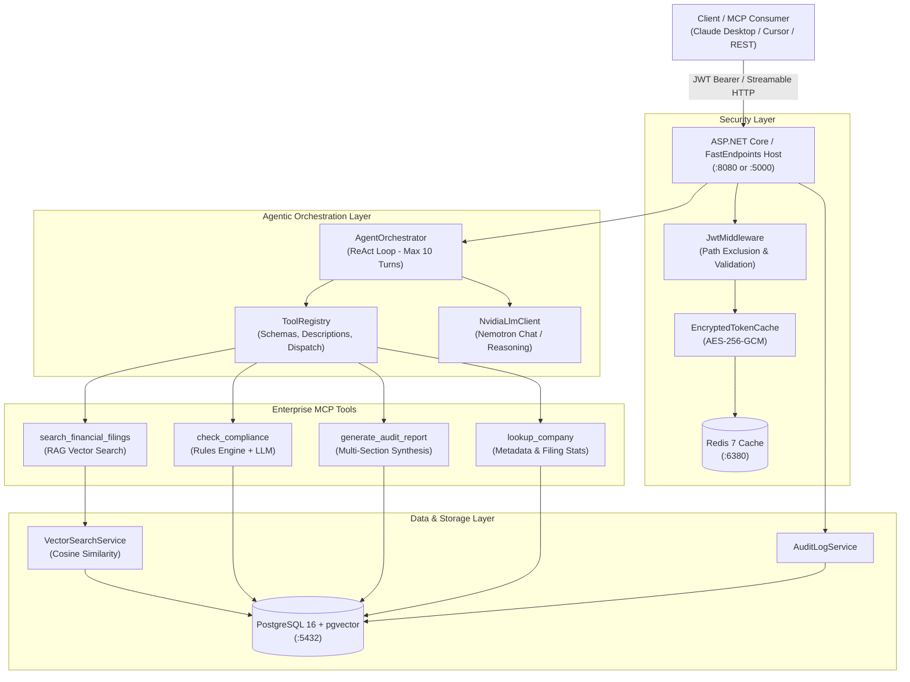
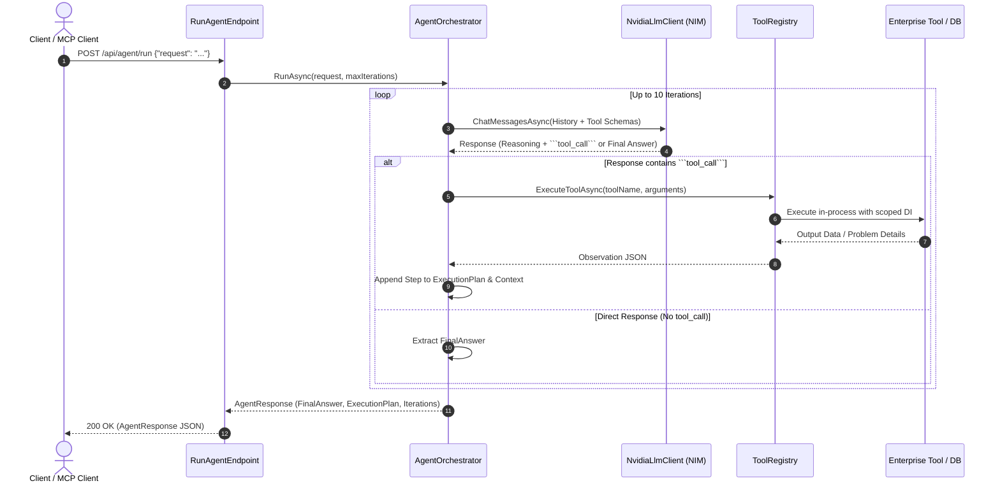
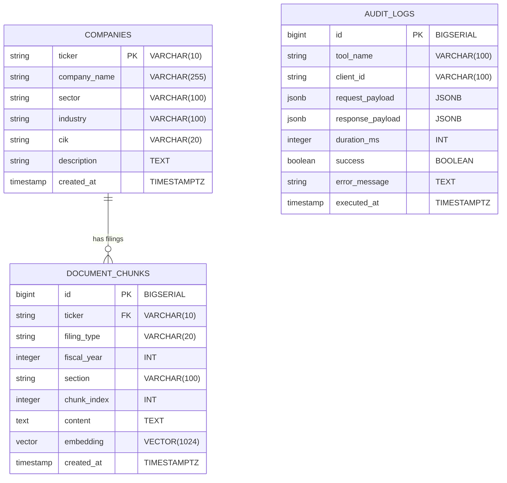

# System Architecture & Technical Specifications

This document outlines the architecture, engineering principles, design choices, and security considerations of the **A2A Enterprise Agentic AI & Model Context Protocol (MCP) Orchestrator**.

---

## 1. High-Level Architecture Overview

The platform is designed around a **Vertical Slice Architecture** built upon **.NET 10** and **FastEndpoints**. It integrates high-throughput REST endpoints, standard Model Context Protocol (MCP) streamable HTTP transports, PostgreSQL with pgvector for semantic retrieval, Redis for AES-256-GCM encrypted token caching, and NVIDIA NIM for enterprise LLM reasoning and embeddings.

---

## 2. Core Architectural Decisions

### 2.1 Why FastEndpoints (vs. Minimal APIs or MVC Controllers)?
- **Vertical Slice Architecture**: FastEndpoints encapsulates Request, Handler, Response, and Validator within cohesive single-file slices rather than scattering logic across controllers, services, and DTO folders.
- **Performance & Zero Reflection Overhead**: FastEndpoints compiles route handlers and model bindings down to expressions, minimizing reflection and memory allocations per request.
- **Native MCP Extension**: Direct support for `FastEndpoints.Mcp`, allowing endpoints to seamlessly register as MCP tools via `this.McpTool(...)` without requiring duplicate server harnesses.
- **Standardized RFC 7807 Problem Details**: Built-in 422 Unprocessable Entity and Problem Details formatting out of the box with zero boilerplate.

### 2.2 Why pgvector & PostgreSQL (vs. Standalone Vector Databases like Pinecone/Milvus)?
- **ACID Compliance & Transactional Integrity**: Storing document embeddings in the same relational database as company metadata and immutable audit logs ensures atomic transactions and zero eventual consistency drift.
- **Relational Filtering with Vector Ranking**: pgvector enables hybrid queries combining relational SQL filters (e.g., `WHERE ticker = @t AND fiscal_year = @y`) with vector cosine distance (`ORDER BY embedding <=> @query_vec LIMIT @k`) in a single indexed query plan.
- **Cost & Operational Simplicity**: Eliminates the operational overhead, network latency, and billing tiers of third-party cloud vector DBs.

### 2.3 Why AES-256-GCM Encrypted Token Caching with Redis?
- **Authenticated Encryption with Associated Data (AEAD)**: AES-256 in Galois/Counter Mode (GCM) guarantees both confidentiality and integrity via a 128-bit authentication tag.
- **Defense in Depth**: Even if Redis memory or snapshots are intercepted, cached authorization tokens cannot be inspected, tampered with, or replayed without detection.
- **Hardware Acceleration**: .NET `System.Security.Cryptography.AesGcm` utilizes CPU-level AES-NI instructions, achieving sub-microsecond encryption and decryption throughput.

### 2.4 Why NVIDIA NIM?
- **Enterprise-Grade Latency & Self-Hostability**: NVIDIA Inference Microservices (NIM) offer optimized TensorRT-LLM execution with high-throughput batching.
- **State-of-the-Art Reasoning**: Utilizes models like `nvidia/nemotron-3.5-super-vl-120b-a12b` and `nvidia/nemotron-3.5-embed-1b` for grounded financial analysis and accurate semantic representation.
- **Resilient Fallback**: The client architecture gracefully fails over to secondary models on transient 429 rate limits.

---

## 3. Autonomous ReAct Agent Loop

The agent loop executes multi-step reasoning tasks autonomously:

---

## 4. Database Schema Design

The PostgreSQL database uses the `vector(1024)` data type and IVFFlat index:

---

## 5. Security Architecture

1. **Authentication**: JWT Bearer with HMAC-SHA256 signatures, validated issuer, audience, and configurable expiry.
2. **Path Exclusion**: `JwtMiddleware` inspects request path before authentication handlers. Safe paths (`/health`, `/auth/token`, `/mcp`, `/`) pass through without Bearer tokens.
3. **Role-Based Access Control (RBAC)**: All tool endpoints enforce `Roles("tool-executor", "admin")`.
4. **Input Validation**: FluentValidation rules enforce strict ticker regex (`^[A-Z]{1,10}$`), query length boundaries, and allowed enum values.
5. **Auditing**: Every tool invocation and agent step is immutably logged to `audit_logs` with execution duration, client identifier, and payload details.
